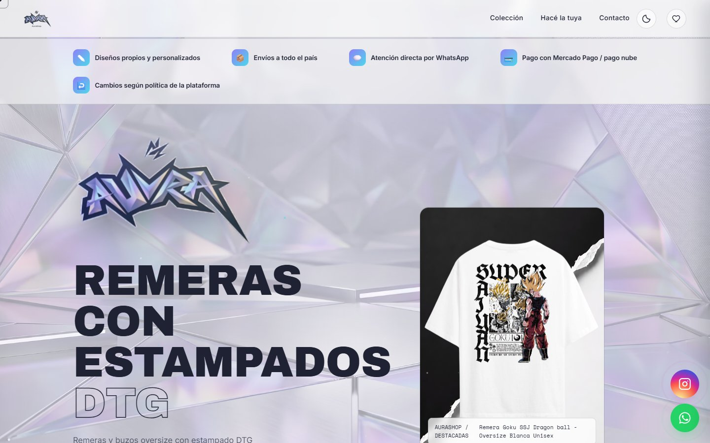
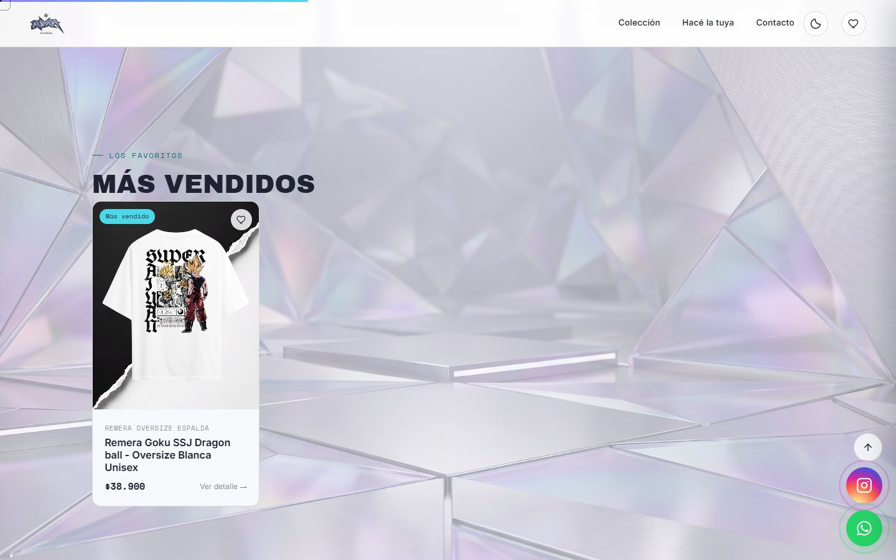
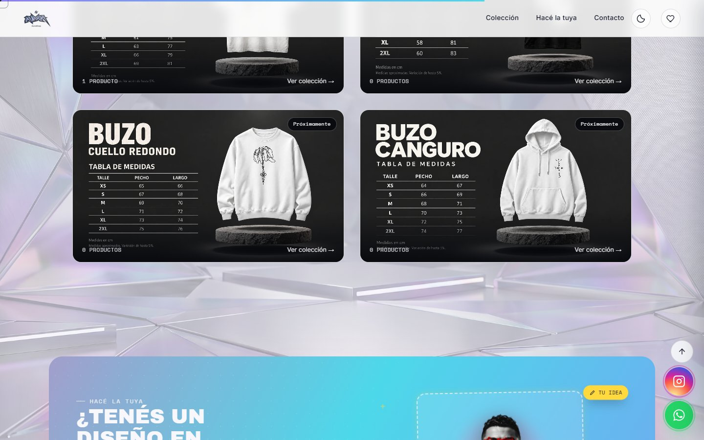
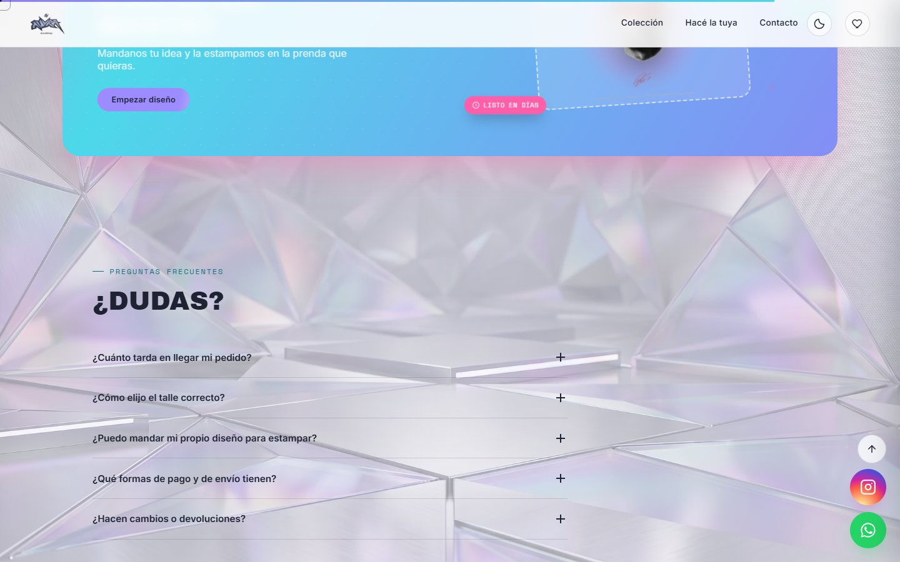
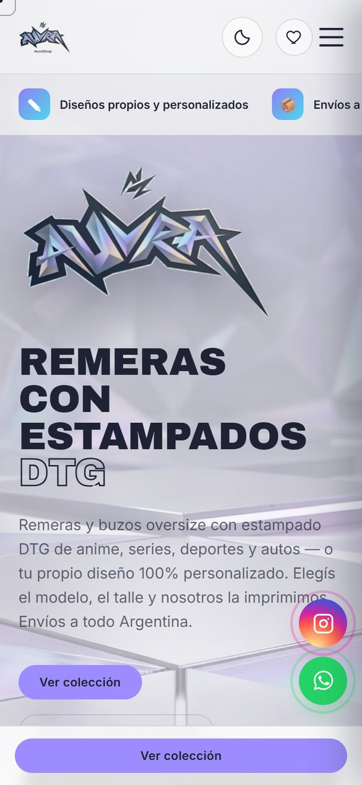

  
  
  
  

Landing page para una marca de remeras y buzos con estampado DTG: catálogo, más vendidos, prendas personalizadas, reseñas, preguntas frecuentes y contacto directo por WhatsApp e Instagram.

> 🔒 **Repositorio vitrina.** El código fuente es privado.

## ✨ Qué tiene

- Portada con estética holográfica y producto destacado.
- Carrusel de **más vendidos** y catálogo por tipo de prenda con **tablas de medidas**.
- Sección **"Hacé la tuya"** para pedir diseños personalizados.
- Reseñas de clientes, preguntas frecuentes desplegables y modo oscuro.
- Botones flotantes de WhatsApp e Instagram.
- Diseño **responsive**, pensado también para celular.

## 📸 Capturas

  
  

  
  

---

© 2026 Tomás Vilche · Todos los derechos reservados

